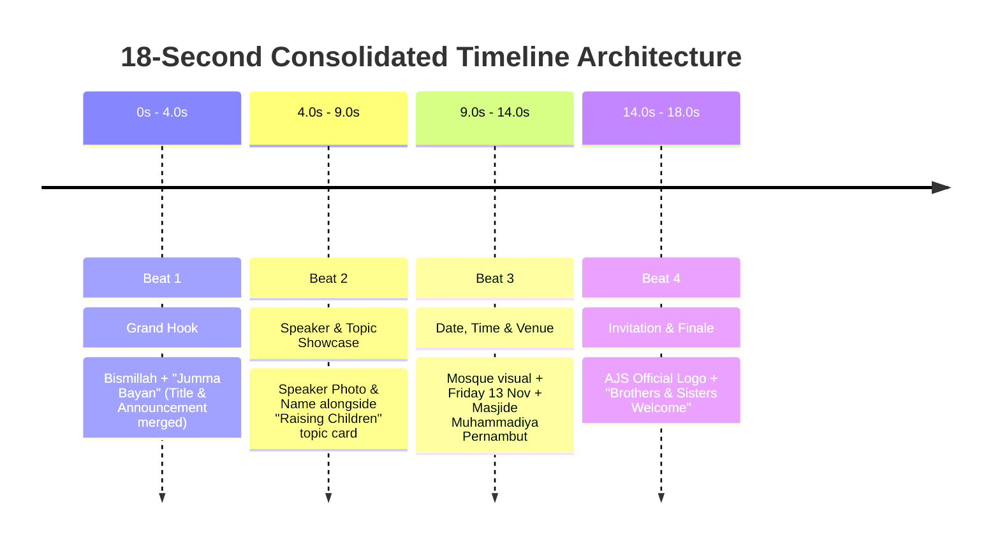

# Complete Audit & Optimization Plan: Jumma Bayan Reel

A comprehensive technical and creative audit of the **Jumma Bayan** HyperFrames project (`jumma-bayan`), combining both visual/craft quality findings and timeline consolidation from **35 seconds down to 18 seconds**.

---

## 1. Executive Summary

| Metric | Current State | Target State | Impact |
|---|---|---|---|
| **Total Duration** | 35 Seconds | **18 Seconds** | Eliminates viewer drop-off on Reels & Status |
| **Total Scenes** | 7 Fragmented Scenes | **4 Consolidated Beats** | Combines related information together |
| **Dead Stasis / Idle Lapses** | ~18 seconds of idle hold time | **< 1.5 seconds per beat** | Snappy kinetic delivery |
| **Linter / Craft Issues** | 5 Warnings (typography floor, occlusion, cover) | **0 Errors, 0 Warnings** | Pixel-perfect mobile compliance |
| **Audio Voiceover** | 7 Separate clips (27.5s speech) | **4 Concise clips (13.4s speech)** | Tight audio-visual alignment |

---

## 2. Full Audit Findings

### A. Timeline & Pacing Issues ("Wasted Time & Idle Lapses")
The current 35-second timeline distributes minimal content across 7 separate scenes, creating significant dead time:

1. **Scene 1 (0.0s – 5.5s)**: Only Arabic Salam & Bismillah. Animation finishes at 1.6s, leaving almost 3 full seconds of static hold.
2. **Scene 2 (4.5s – 10.0s)**: Only the title "Jumma Bayan". Over 5 seconds dedicated to two words with 55% empty black background.
3. **Scene 3 (9.0s – 15.2s)**: Speaker alone on screen for >5 seconds without topic context.
4. **Scene 4 (14.0s – 20.2s)**: Topic card alone on screen for >5 seconds disconnected from the speaker.
5. **Scene 5 (19.0s – 25.5s)**: Mosque image + date/venue held for 5.6 seconds.
6. **Scene 6 (24.5s – 30.5s)**: Standalone 5-second scene just for the AJS logo and "Cordially Invited By".
7. **Scene 7 (29.5s – 35.0s)**: Standalone 5.5-second scene with only "Everyone is welcome".

### B. Automated Craft & Linter Checks (`npm run check`)
- **`first_frame_empty` (Craft Warning)**:
  - Frame 0 (`t=0s`) is covered by `.bg-base` with content starting at `t=0.3s`. On social media, frame 0 is frequently picked as the video thumbnail cover.
- **`text_below_floor` (Craft Warning)**:
  - 13 text elements have font sizes below 28px (the recommended mobile floor for 1080x1920 viewport), including metadata tags (20px–24px).
- **`text_occluded` & Contrast (Warnings at `t=9.72s`)**:
  - 1.0s blur crossfades cause overlapping opaque DOM elements between Scene 2 and Scene 3 during transition.
- **`text_box_overflow` (Arabic Diacritics)**:
  - Arabic script in Amiri font (`السَّلَامُ عَلَيْكُمْ...` and `بِسْمِ اللَّهِ...`) overflows its standard CSS line-box vertically by 8px–17px due to vocalization marks (tashkeel).

---

## 3. Consolidated 4-Beat Architecture (18s)



### Detailed Breakdown of Consolidated Beats

#### Beat 1 (0.0s – 4.0s): Grand Hook & Event Title
- **Content**: Assalamu Alaikum & Bismillah + Hero title **"Jumma Bayan"** with gold shimmer badge ("Coming Friday, Insha Allah").
- **Voiceover (VO 1)**: *"Assalamu Alaikum. Jumma Bayan, coming this Friday."* (~2.8s)
- **Eliminates**: The duplicate, empty title card (formerly Scene 2).

#### Beat 2 (4.0s – 9.0s): Speaker & Topic Card
- **Content**: Arched portrait of **Brother K. Mohammed Nasir Umari** paired directly with the **"Raising Children"** topic card in a unified layout.
- **Voiceover (VO 2)**: *"Guest Speaker Brother K. Mohammed Nasir Umari, on Raising Children."* (~3.8s)
- **Eliminates**: Switching back and forth between two standalone 5-second slides for speaker and topic.

#### Beat 3 (9.0s – 14.0s): Date & Venue Presentation
- **Content**: Mosque visual set in a frosted-glass card, accompanied by bold date badge (**Friday 13 Nov**) and venue (**Masjide Muhammadiya, Pernambut**).
- **Voiceover (VO 3)**: *"Friday, 13th November at Masjide Muhammadiya, Pernambut."* (~3.6s)
- **Enhancement**: Frosted-glass container with clean gold borders and typography scaled $\ge$ 28px.

#### Beat 4 (14.0s – 18.0s): Organizer Invitation & Closing
- **Content**: Official glowing **AJS Logo** + "Cordially Invited by Al Jam'iyyathus Salafiyya" + "All Are Welcome (Brothers & Sisters)".
- **Voiceover (VO 4)**: *"Cordially invited by Al Jam'iyyathus Salafiyya. All are welcome."* (~3.2s)
- **Eliminates**: Having two redundant 5-second closing slides at the end of the video.

---

## 4. Implementation Steps

### Step 1: Voiceover Regeneration (`generate_vo.py`)
Regenerate 4 concise voiceover files to replace the existing 7:
```python
clips = [
    ("vo-scene1.mp3", "Assalamu Alaikum. Jumma Bayan, coming this Friday.", "en"),
    ("vo-scene2.mp3", "Guest Speaker Brother K. Mohammed Nasir Umari, on Raising Children.", "en"),
    ("vo-scene3.mp3", "Friday, 13th November at Masjide Muhammadiya, Pernambut.", "en"),
    ("vo-scene4.mp3", "Cordially invited by Al Jam'iyyathus Salafiyya. All are welcome.", "en"),
]
```

### Step 2: HTML Overhaul (`index.html`)
- Update composition duration attribute: `data-duration="18"`.
- Configure audio elements: 
  - `bgm`: `data-duration="18"`, `data-fade-out="2"`.
  - 4 `<audio>` tags for `vo-scene1.mp3` through `vo-scene4.mp3`.
- Replace 7 scene containers with 4 structured beat containers.
- Add `data-layout-allow-overflow` and `data-layout-allow-occlusion` where appropriate.

### Step 3: Motion Engine Retiming (`main.js`)
- Retime camera rig push-in from 35s to 18s:
  ```javascript
  tl.fromTo("#camera-rig", { scale: 1.0, y: 0 }, { scale: 1.06, y: -25, duration: 18, ease: "none" }, 0);
  ```
- Timeline transitions:
  - Beat 1: `0.0s – 4.0s` (reveals in at 0.2s, dissolves at 3.6s)
  - Beat 2: `3.8s – 9.0s` (reveals in at 4.0s, dissolves at 8.6s)
  - Beat 3: `8.8s – 14.0s` (reveals in at 9.0s, dissolves at 13.6s)
  - Beat 4: `13.8s – 18.0s` (reveals in at 14.0s, holds until 17.5s)
- Snappy easing (`expo.out` over 0.7s) to remove static lag.

### Step 4: CSS Polish & Typography Scaling (`style.css`)
- Set minimum font size for secondary labels to $\ge 28\text{px}$ (e.g. `font-size: 28px; line-height: 1.3;`).
- Add vertical breathing room for Arabic text (`padding: 10px 0; line-height: 1.5;`) to avoid tashkeel clipping.
- Implement glassmorphic card containers for Date/Venue and Speaker/Topic pairings.

---

## 5. Verification Plan
1. **TTS Generation**: Run `python3 generate_vo.py` and verify all 4 audio files exist and match durations.
2. **Linter & Craft Verification**: Run `cd jumma-bayan && npm run check` to ensure 0 errors and 0 warnings.
3. **Frame Snapshots**: Run `npx hyperframes snapshot --at 2,6,11,16` and inspect the generated `contact-sheet.jpg`.
4. **Visual & Audio Check**: Verify that every beat is packed with relevant information without awkward pauses.
